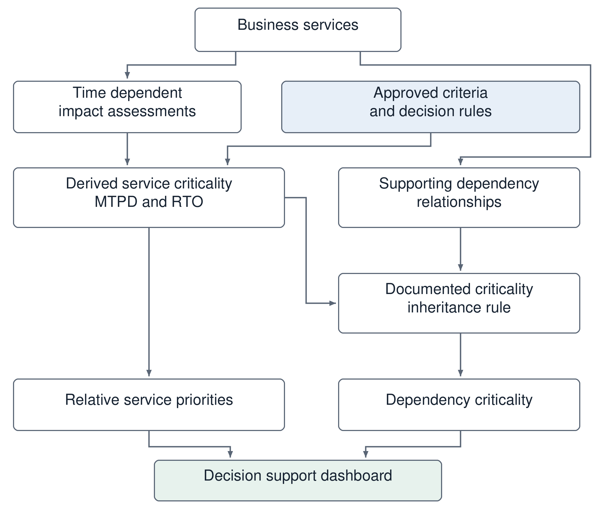

# Literature Review

## Introduction

Business continuity decisions connect organizational obligations with the practical limits of recovery. Identifying an important service is only the beginning: continuity personnel must explain how disruption affects that service over time, when its consequences become unacceptable, and which supporting resources make its delivery possible. This chapter examines the literature relevant to that reasoning. It develops the basis for Time-Dependent Recovery Prioritization (TDRP) and its implementation in Masar, while distinguishing a reproducible assessment procedure from an operational recovery schedule. The central argument is that established continuity concepts provide a credible foundation for a configurable service-level procedure, but neither formal rules nor a dashboard, by themselves, establish that recovery objectives are achievable.

The review proceeds from the wider continuity-management context to the specific decision addressed by the project. It first considers the scope and limitations of the evidence, then examines business continuity, business impact analysis (BIA), recovery parameters, prioritization methods, and dependency relationships. Research prototypes and operational software are compared according to the decisions they support. The final synthesis identifies the contribution that this master's project can reasonably pursue and the evidence needed to evaluate it. Throughout the chapter, statements about TDRP and Masar describe the proposed artifact and the interpretation developed here; they are not findings from an already completed implementation.

## Review Approach and Evidence Boundaries

### Scope and source selection

This chapter adopts a focused, critical narrative review. Its purpose is to inform the design and evaluation of a master's project in information systems, rather than to estimate an intervention effect or demonstrate exhaustive coverage of every continuity publication. The starting material comprised the project introduction, its reference list, the saved Paperguide project folder, and the associated literature-review document. These materials were used to identify relevant concepts and candidate studies. Bibliographic details and substantive claims were then checked against retrieved paper records, available full text, official guidance, and original software documentation. The research materials were consulted on 1 November 2026.

Selection was guided by the project's decision problem. Priority was given to work that explains at least one of the following relationships: disruption consequences and service criticality; elapsed time and recovery requirements; assessment criteria and priority decisions; services and supporting dependencies; or analytical results and their presentation to decision makers. Foundational studies were retained where they directly define a method or research system. More recent work was considered where it develops the treatment of uncertainty, dependencies, or organizational continuity. Software documentation was included to avoid comparing a proposed system only with academic prototypes while overlooking existing operational capabilities.

The resulting body of evidence is deliberately heterogeneous. Standards and public guidance explain expectations and terminology; they do not establish the empirical effectiveness of a particular ranking rule. Research articles offer models, case applications, surveys, or prototypes. Official product pages describe declared software capabilities, which may depend on licensing, configuration, and version. Their inclusion therefore supports a functional comparison, not an independent performance ranking. This distinction is particularly important when examining broad claims about integration: the existence of BIA, dependency mapping, and recovery-planning features in one product does not disclose its exact internal derivation logic.

### Critical synthesis and limitations

The synthesis compares studies by their unit of analysis, decision purpose, treatment of time, representation of dependencies, and evaluation basis. These dimensions prevent superficially similar outputs from being treated as equivalent. A component-restoration schedule, a stakeholder-preference ranking, and a service-criticality classification may all be called priorities, but they answer different questions. The review consequently asks what information a method requires, what its output means, and which conclusions can transfer to a service-oriented DSS. Where a paper was available only through its abstract or bibliographic record, discussion is limited to the methods and findings reported there; unobserved implementation details are not inferred.

No independently auditable record of the earlier Paperguide screening decisions was available to this review. Accordingly, this chapter does not reproduce the generated draft's record counts, claim PRISMA compliance, or characterize the search as systematic. Nor does it treat the number of saved references as the number of studies critically appraised. Full-text access was uneven, and commercial products were examined through selected official documentation rather than installed trials. These constraints limit claims about completeness and comparative effectiveness. They do not prevent an evidence-grounded design argument, provided that the argument separates established concepts, reported results, and the proposed contribution.

## Business Continuity and Organizational Resilience

### Continuity as an organizational capability

ISO 22301:2019 situates continuity within a management system that is established, operated, reviewed, and improved [@iso22301]. This framing places recovery requirements within organizational governance rather than treating them as isolated technical settings. The Saudi National Framework for Risk, Emergency and Business Continuity Management similarly provides the national context used in Chapter 1 [@nrcnationalframework]. For Masar, the implication is that an assessment belongs to an accountable organizational process. A calculated priority should have an identifiable service, assessment basis, and approved interpretation. Its existence in software does not replace the authority that determines acceptable consequences or authorizes recovery action.

Business continuity and information-technology disaster recovery overlap, but their objects differ. A business service is an outcome delivered to beneficiaries; an application, network, or database enables part of that delivery. Technical restoration may be necessary without being sufficient. For example, an available application cannot deliver a public service if an essential external approval or trained operator remains unavailable. Conversely, a manual procedure may sustain a limited service while a technical component is restored. NIST's contingency-planning guidance helps relate information-system recovery to business processes and their recovery needs [@nist2010]. The service-first orientation of TDRP is therefore a choice of analytical level, not a claim that technical recovery is secondary in every incident.

This distinction also affects the meaning of success. A technical team can demonstrate that a server starts from backup; a continuity team must still determine whether the required service can operate at an acceptable level. A useful assessment must make clear whether its recovery target concerns minimum service delivery, full capacity, or a particular enabling system. Otherwise, departments can appear to agree on an RTO while referring to different end states. The project addresses the consistency of those recorded requirements and their derivation. It does not establish the recovery capability of every resource represented in the service portfolio.

### Embedded practices and uncertainty

Järveläinen investigated information-system continuity through a survey of IT managers and chief information officers in large Finnish public and private organizations [@jarvelainen2013]. The reported relationship between embedded continuity practices and perceived business impacts gives an organizational basis for considering how continuity information becomes part of routine work. The study did not find the same direct relationship for organizational alertness and preparedness. Its results should not be converted into a claim that preparedness is unnecessary: the variables, setting, and perceived outcomes constrain that interpretation. For this project, the relevant lesson is narrower. A technically correct assessment tool needs information-maintenance practices and users who understand how its outputs relate to business responsibilities.

Steen, Haug, and Patriarca connect continuity management with resilience engineering and question assumptions of stable, decomposable systems and sufficiently predictable disruption behaviour [@steen2024]. Their Norwegian emergency-response case example illustrates the proposed framework, while the paper explicitly leaves final artifact evaluation outside its scope. The study therefore supports a critique of overconfidence in formal planning, rather than proving that one resilience framework improves recovery outcomes. In Masar, this critique motivates clear explanation of the status of a priority: it expresses assessed requirements under declared assumptions, not a prediction of exactly how an emergency will unfold.

Baham et al. provide a complementary perspective through action research on an adapted Kanban approach in enterprise disaster recovery [@baham2017]. Their reported experience favours adaptive coordination when unexpected and cascading consequences emerge. Unlike a pre-disruption classification procedure, this work concerns how recovery activity is organized during a demanding event. Taken together, these studies indicate that assessment consistency and operational adaptability address different needs. TDRP can standardize how comparable inputs are interpreted while responsible personnel retain the ability to revise decisions in response to actual conditions. The literature does not justify presenting a previously computed service ranking as an immutable command sequence.

### Implications for the project boundary

The organizational literature changes how the contribution should be stated. Masar is intended to make a particular chain of reasoning inspectable: assessed impacts lead to service classifications and recovery requirements, and these outputs inform relative priorities and the interpretation of supporting dependencies. This is a contribution to decision support. It is not, by itself, a demonstration of improved organizational resilience, reduced incident losses, or successful continuity certification. Those outcomes depend on recovery arrangements, exercises, governance, resources, and incident conditions beyond a prototype's calculation functions.

This boundary provides a practical evaluation advantage. A master's project can examine whether a rule is correctly implemented, whether repeated assessments produce consistent outputs, and whether users can trace an output to its inputs. Such questions are narrower than whether an organization will survive an extreme event, but they are answerable. They also avoid confusing the availability of a well-presented dashboard with the validity of the policy encoded in it. The quality of the policy and the correctness of its execution require related but separate judgments.

## Business Impact Analysis and Recovery Requirements

### BIA as the connection between services and recovery

ISO/TS 22317:2021 describes BIA as a documented process adaptable to organizational needs and explicitly does not prescribe one uniform procedure [@iso22317]. Its published introduction connects disruption impact over time with continuity priorities, recovery requirements, and dependencies. This provides a basis for configurable assessment while also setting a limit: organizational freedom to configure a method is not evidence that every configuration is defensible. Impact scales and thresholds require a substantive justification. A system can apply a selected rule consistently even when that rule poorly represents the consequences of disruption.

Torabi, Rezaei Soufi, and Sahebjamnia developed a BIA framework using multi-attribute decision-making techniques to identify key products or services, critical functions, MTPD, and the minimum business continuity objective (MBCO) [@torabi2014framework]. A case application in an auto-parts manufacturer demonstrates the framework's applicability in that setting. This is directly relevant precedent: explicit analytical procedures for BIA and tolerable disruption already exist. TDRP should therefore be positioned through its particular configurable service-level interpretation and implementation, rather than through the claim that earlier BIA work provides no computational method. Transfer from manufacturing functions to a wider service portfolio nevertheless requires examination of criteria, assessment periods, and stakeholder interpretation.

Al-Essa and Al-Sharidah address the practical challenge of collecting and maintaining application-level continuity information [@alessa2018]. Their seven-phase approach includes business analysis, questionnaire development, automation, workshops, data gathering, prioritization, and management approval. The described central repository supports collection of RTO and RPO information. This establishes a useful distinction between collecting an asserted requirement and deriving one from time-dependent impact evidence. Both may be valuable, but they should remain distinguishable in the data and in evaluation. Agreement between a computed RTO and an entered RTO is meaningful only if the two were obtained independently and refer to the same recovery scope.

These contributions expose a recurring problem of organizational granularity. Products, services, functions, activities, applications, and assets are related, but are not interchangeable records. If one department assesses a service while another assesses its database, their rankings cannot be compared without interpreting the relationship. For Masar, the service is the primary assessed entity. Dependencies are associated with that entity after its business-level classification. This choice makes the direction of reasoning explicit, while leaving detailed process modelling and infrastructure simulation outside the current scope. A service catalogue still requires clear boundaries so that one broad service does not conceal several activities with substantially different time sensitivities.

### Impact dimensions and temporal assessment

Disruption affects organizations through more than financial loss. The DGA guidance distinguishes financial, stakeholder, reputational, and legal or regulatory effects in its classification of government platforms and applications [@dga2025bcm]. Its discussion of assessment intervals also recognizes that organizations differ in how soon disruption becomes consequential. The guidance supplies a concrete regional reference for the project's emphasis on time, but its platform categories should not be transplanted without examining the target organization's obligations. The rule used to combine impact dimensions must also be distinguished from the later rule used to assign criticality to a dependency shared by several services.

In a time-dependent assessment, each judgment must answer a sufficiently precise question. An impact assessed after four hours of complete interruption differs from an impact after four hours of reduced operation. The start of an interruption, operating calendar, peak demand, and existing workaround can change the interpretation. The project need not model every scenario to acknowledge these conditions. It should ensure that the assumptions accompanying an assessment are coherent enough for its output to be understood. A precise timestamp has little value if assessors disagree about what has been unavailable during the period it measures.

Impact scales require similar care. Labels such as low, moderate, high, and critical form an ordered classification, but do not automatically define equal numerical distances. Assigning the numbers one to four does not demonstrate that a critical impact is four times a low impact. Arithmetic aggregation can therefore introduce an assumption that was absent from the original judgments. A maximum-category rule preserves the most severe classification, while a weighted sum permits compensation between dimensions. Neither is universally appropriate. The decision depends on whether, for instance, an unacceptable legal consequence is allowed to be offset by small financial loss. This is a policy question that must be made visible before the computational rule is evaluated.

Time intervals introduce a second source of interpretation. If impacts are observed at one, four, eight, and twenty-four hours, a threshold first observed at eight hours does not reveal its exact crossing time. It locates that crossing within the resolution of the assessment. Treating the observation as an exact physical measurement would overstate the evidence. The methodological chapter must specify whether TDRP reports the first assessed unacceptable interval, uses a conservative earlier boundary, or applies another approved convention. This chapter establishes the need for that decision without presenting an untested convention as a standard requirement.

Resilience measurement provides a related, but distinct, treatment of time. Henry and Ramírez-Márquez formulate time-dependent system-resilience metrics and illustrate their use through a road-network example [@henry2012]. Poulin and Kane review resilience curves and show why the selected performance measure, reference level, and summary metric affect the interpretation of system behaviour [@poulin2021]. Together, these studies support explicit temporal definitions rather than a timeless label of importance. They do not establish that performance loss and organizational impact are identical quantities. A brief interruption of a deadline-bound service may have severe consequences even if an aggregate performance measure suggests a modest loss.

This distinction limits the direct transfer of a resilience curve into a BIA rule. A curve can describe the fraction of demand served, while an impact assessment may express legal consequences or reputational concern through ordinal categories. Combining the two requires a justified relationship between the measures. Masar's use of successive impact assessments is therefore not a claim to estimate a continuous resilience function. It is a structured representation of organizational judgments at declared periods. The representation can support transparent comparison, provided that the precision of its output does not exceed the resolution and meaning of the original assessments.

### MTPD RTO RPO and minimum service delivery

Recovery parameters capture different dimensions of continuity. MTPD concerns the duration beyond which disruption effects become unacceptable; RTO states a target for resumption; RPO concerns the acceptable recovery point for information. NIST additionally discusses maximum tolerable downtime and the relationship of system recovery to business-process needs [@nist2010]. Terminology must be interpreted in context rather than assuming that all publications use identical definitions. In this project, RPO is reviewed because it is central to technical recovery, but deriving RPO is not among the service-level outputs specified in Chapter 1.

Table 2.1 summarizes the distinctions used in this review. Its practical purpose is to prevent a common category error: a recovery objective is a requirement, whereas an observed restoration duration is evidence about capability. A target of four hours and a tested duration of six hours indicate a gap to investigate. The target does not become six hours simply because that is what the current arrangement achieves. Equally, an ambitious target does not establish that the organization can meet it.

| Parameter | Question addressed | Interpretation for Masar |
| --- | --- | --- |
| MTPD | When do interruption consequences become unacceptable? | Derived requirement under an explicit temporal convention |
| RTO | By when should the defined service level resume? | Target mapped through approved rules and reviewed for feasibility |
| RPO | To which earlier point should information be recoverable? | Related data-recovery requirement outside the proposed derivation scope |
| MBCO | What minimum delivery level is acceptable during disruption? | Context needed to interpret what resumption means |
| Achieved recovery time | How long did recovery actually take? | Evidence from a test or incident rather than a BIA-derived target |

The separation between MTPD and RTO is especially consequential. An unacceptable-impact boundary does not determine a unique feasible recovery target. An organization may need time after technical restoration to verify information, clear backlogs, and resume delivery. The methodological problem is therefore not solved by renaming the threshold-crossing time as RTO. TDRP must state the relationship it adopts and the assumptions on which it depends. An inconsistent configuration should be identified as such, rather than producing an apparently authoritative value merely because all required fields contain data.

The absence of an observed threshold is also informative. A service whose assessed effects remain below the unacceptable category throughout the available horizon cannot automatically be assigned an infinite MTPD. The evidence supports only the statement that the boundary was not observed within that horizon. Similarly, a missing impact response is not a low impact. Both cases should retain a distinguishable status. These are analytical implications of the project's time-dependent representation, and they are important candidates for correctness tests because conventional examples often show only complete inputs with an obvious threshold.

### Linking requirements with recovery capability

Sahebjamnia, Torabi, and Mansouri integrate business continuity and disaster recovery planning through a multi-objective mixed-integer model that allocates internal and external resources to resumption and recovery plans [@sahebjamnia2015integrated]. Their framework connects strategic context, tactical allocation, and operational examination of disruption scenarios, with a real case application. This work shows that recovery requirements and resource decisions can be treated together analytically. It also clarifies the narrower position of TDRP: deriving and explaining service requirements does not solve the allocation problem that determines whether all services can actually recover within them.

For the proposed DSS, the resulting boundary should remain explicit in both the chapter and the interface. A service can rank first while still depending on an unavailable supplier or a resource whose restoration takes longer than the approved RTO. Masar's role is to preserve the relationship between that service, its priority, and its supporting dependencies. It should not imply that a priority guarantees feasibility. Feasibility requires evidence about operational arrangements and constraints, which may be established through separate planning, testing, or subsequent research.

## Methods for Recovery Prioritization

### Rules and multicriteria assessment

Prioritization methods differ first in the decision alternatives they compare. A BIA may compare services, a risk assessment may compare threats, and a continuity investment exercise may compare alternative protective measures. Merz, Hiete, and Bertsch use multicriteria decision analysis to evaluate business continuity measures in the context of critical-infrastructure disruption affecting industrial production [@merz2009]. Their contribution is relevant because it treats continuity choices as involving multiple consequences rather than a single technical measure. It is not a direct validation of a service-ranking rule: selecting a mitigation measure and ordering services for recovery involve different alternatives and constraints.

Aghabegloo et al. combine BIA, a physical-asset risk assessment matrix, fuzzy best-worst weighting, TOPSIS, and continuity-parameter modelling in a petrochemical case [@aghabegloo2024]. Their asset-oriented framework illustrates how uncertainty and multiple criteria can enter a formal criticality assessment. It also combines likelihood with consequence, whereas the proposed service-level TDRP procedure begins with the consequences of interruption over time. This difference matters. A rare disruption affecting a time-critical service can still justify a demanding recovery requirement. Incorporating likelihood into the same score changes the question from tolerable interruption to a broader risk-based allocation decision.

Multicriteria methods make preferences explicit, but their outputs depend on the chosen criteria, scales, weights, and aggregation. A ranking can change when a weight changes without any underlying business service changing. That is not necessarily a flaw: different weights may represent different legitimate priorities. The difficulty arises when the resulting order is presented as if it were an objective property of the services themselves. For TDRP, a configurable rule should therefore expose the policy interpretation that produces a classification. Evaluation must examine the validity of the selected interpretation as well as the repeatability of calculation.

A rule-based approach can be understood as a declared mapping from specified conditions to outcomes. A rule might classify a service from the highest qualifying impact, identify a temporal boundary, and then order services using criticality and recovery-time requirements. The value of such a procedure lies in the ability to inspect why the outcome follows. However, transparency does not establish that the rule is optimal. A simple rule can be clearly wrong, and a complex model can be appropriate when its data and purpose justify it. The relevant comparison is therefore between suitability for the decision, required evidence, and interpretability, rather than between simplicity and sophistication as ends in themselves.

The treatment of ties illustrates this issue. Two services may share the same criticality and RTO. An arbitrary record identifier can impose a display order, but does not supply a business reason to recover one before the other. A responsible interpretation distinguishes equal analytical priority from a deterministic screen arrangement. If additional criteria are introduced to resolve ties, their authority and meaning must be specified. Otherwise, a routine interface choice silently becomes a recovery policy. The methodological chapter should make this distinction explicit rather than allowing incidental database or sorting behaviour to decide it.

### Simulation and business process models

Tjoa, Jakoubi, and Quirchmayr extend the Risk-Oriented Process Evaluation methodology to enhance BIA and risk assessment through risk-aware business-process modelling and simulation [@tjoa2008]. This work treats resource disruption in relation to business processes and examines continuity-planning support. Its relevance is the analytical connection between enabling resources and business consequences. Simulation, however, requires a behavioural model and assumptions about how activities, failures, and recovery develop. Those requirements differ from interpreting recorded assessments through explicit rules. Masar's current scope does not include executing such simulations, although the study informs the importance of retaining service-resource relationships.

Simulation is especially useful when the question concerns how a disruption unfolds under a specified set of conditions. It can examine delays, queues, resource contention, or alternative restoration arrangements that a static classification does not represent. Its output remains conditional on model adequacy and input assumptions. A detailed trajectory does not remove uncertainty merely because it is expressed numerically. Before comparing a simulation with TDRP, the analyst must determine whether the two address the same outcome. Agreement on a priority label does not establish that a rule-based assessment reproduces the dynamic behaviour of the simulated organization.

For this project, simulation research therefore serves two purposes. It shows that business consequences can be connected computationally with resource conditions, and it identifies capabilities that lie beyond the proposed artifact. The appropriate response is to preserve a coherent representation that supports later interpretation, rather than expanding Masar into a simulator without the corresponding research design. A clear limitation is preferable to an untested feature whose outputs appear more precise than the evidence supporting them. This is particularly relevant to a master's project, where the evaluation must remain proportionate to the implemented contribution.

### Optimization and constrained recovery

Alkhaleel, Liao, and Sullivan formulate a two-stage mean-risk stochastic mixed-integer restoration model for interdependent infrastructure networks [@alkhaleel2022]. The model considers uncertainty, limited time and resources, unsatisfied demand, repair work, and network flows. It generates component priorities together with crew assignments and scheduling, and is illustrated through power and water networks in Shelby County under hypothetical earthquake scenarios. This is a materially different decision from TDRP's relative service prioritization. A schedule embeds feasibility constraints and resource interactions; a ranked list of services does not.

An optimization model also requires an explicit objective. Minimizing disruption cost, protecting the most time-sensitive service, and maximizing restored demand can lead to different choices. None is automatically the correct representation of every organization's obligations. In the proposed project, TDRP's declared rules represent a selected organizational interpretation of assessed impact and recovery needs. They do not claim to solve a global restoration optimum. The literature consequently supports evaluating the rule against its stated specification and expert expectations, while reserving comparisons with optimization for cases where alternatives, objectives, constraints, and available information are genuinely comparable.

This separation avoids an otherwise misleading performance claim. A computationally fast rule is not necessarily better than a slower optimization model if it omits the constraints that determine feasibility. Conversely, a mathematically optimal schedule is not useful if the organization cannot provide credible repair durations, costs, or resource availability. Method choice must follow the decision and the available evidence. For Masar, the principal requirement is a traceable interpretation of service-level BIA. Resource-constrained scheduling would require an additional model, additional inputs, and an evaluation designed for that different purpose.

### Comparing methodological commitments

Table 2.2 compares the methodological families discussed above. The entries describe analytical commitments rather than rank their quality. In practice, an organization may combine them: BIA identifies requirements, multicriteria analysis compares measures, simulation explores behaviour, and optimization allocates constrained resources. A rule-based DSS can occupy a useful position in that sequence without replacing every other method. The project is strongest when it identifies that position precisely.

| Method family | Main decision | Principal information needed | Main qualification |
| --- | --- | --- | --- |
| Explicit rules | Apply approved classification and ordering policy | Impacts, assessment periods, thresholds, mappings | Consistency does not establish policy validity |
| Multicriteria analysis [@merz2009;aghabegloo2024] | Compare alternatives under several criteria | Scales, weights, preferences, alternatives | Ranking depends on aggregation assumptions |
| Process simulation [@tjoa2008] | Explore consequences under modelled conditions | Behaviour, resources, events, time assumptions | Model fidelity limits transferability |
| Integrated planning [@sahebjamnia2015integrated] | Relate continuity plans and resource allocation | Recovery alternatives and resource requirements | Requires a specified planning context |
| Stochastic optimization [@alkhaleel2022] | Schedule constrained restoration under uncertainty | Networks, crews, costs, scenarios, durations | Optimality applies to the formulated model |

The comparison also clarifies what reproducibility means. A method is computationally reproducible when the same defined inputs and configuration produce the same result. Assessment reproducibility is more demanding: independent assessors must interpret service boundaries, scales, and periods in a sufficiently similar way. TDRP can directly address the former and investigate the latter through expert review or user evaluation. It cannot assume that deterministic processing makes the underlying organizational judgments objective. The distinction should guide both test cases and the claims made about the resulting prototype.

## Dependencies and the Interpretation of Criticality

### From individual resources to connected services

Theocharidou, Kotzanikolaou, and Gritzalis propose a multi-layer criticality-assessment methodology covering operator, sector, and wider cross-sector relationships [@theocharidou2010]. The study emphasizes that dependencies transmit threats and impacts across assessment boundaries. Its setting is infrastructure protection at a scale broader than Masar's organizational service portfolio. Nevertheless, it provides a clear analytical warning: evaluating an entity in isolation can omit consequences that arise through the entities relying on it. Transfer to this project concerns the need to represent relationships explicitly, rather than adoption of every layer or metric in the original methodology.

Laugé, Hernantes, and Sarriegi examine critical-infrastructure dependencies with a holistic and time-dependent perspective informed by expert survey evidence [@lauge2015]. Their approach considers both how an infrastructure's failure affects others and how it is affected by another failure. This directional distinction is relevant to service portfolios. A dependency record should identify what relies on what; the statement that two entities are connected does not establish equal consequences in both directions. The study also highlights the difficulty of obtaining sensitive dependency information, which cautions against assuming that a comprehensive diagram necessarily represents complete knowledge.

Neovius, Petre, and Sere offer a formal perspective through a dependency operator in the Action Systems framework [@neovius2016]. Their analysis distinguishes dependency from simple sequential composition and examines conditions under which algebraic properties and refinement hold. The accompanying examples demonstrate that the ability to perform an action can require another condition to remain available, rather than merely occur earlier. This theoretical study does not prescribe a BCM criticality scale or a rule for shared resources. Its contribution here is conceptual precision: a dependency relation needs a declared meaning before any classification is propagated through it.

For Masar, those findings support a restrained relationship model. A service can rely on an application, supplier, facility, person, information resource, or another enabling element. Recording that association preserves the business context of the resource. It does not automatically quantify the probability that its failure will stop the service, the duration before a workaround is exhausted, or the fraction of capacity that remains. Such properties require additional evidence and modelling. A visible relationship should therefore be read as an assessed association, with its meaning explained, rather than as a complete causal model of interruption.

### Shared dependencies and inherited criticality

Chapter 1 proposes assigning a supporting dependency the highest criticality among the services it supports, subject to evaluation. This is an ordinal inheritance rule: it uses the ordering of categories without assuming equal distances between them. Consider a shared authentication service supporting two business services classified as critical and moderate. Under the proposed default, the dependency inherits critical. The result explains why the dependency deserves attention in the service portfolio. It does not mean that every failure of authentication produces the full impact of the critical service, because that inference would require knowledge of redundancy, alternative access, and the actual interruption.

The rule has an intelligible precautionary rationale. Averaging the two service classifications could dilute the requirement of the more time-sensitive service, particularly when several less critical services share the same resource. Yet the maximum rule also loses information. It does not distinguish a dependency supporting one critical service from another supporting many critical services, nor does it measure the intensity of dependence. These limitations should remain visible rather than being addressed by quietly adding an unsupported numerical multiplier. Displaying the supported services alongside the inherited category preserves some of the context that the category alone cannot carry.

There are also important boundary cases. A dependency with no recorded service association is unclassified by this particular rule; it is not thereby proven unimportant. Removing an association can change a derived category, but that change may reflect data maintenance rather than a real reduction in organizational exposure. Several services can also share both a primary and a fallback resource. Merely counting both as equivalent dependencies can obscure their roles. The project need not implement a complete redundancy model, but its assessment procedure should avoid presenting incompletely described relationships as definitive evidence of operational vulnerability.

The inheritance rule should not be confused with priority propagation. A resource's inherited criticality is derived from service classifications; it does not create a second, independent assessment of business impact. Feeding that category back into the original service assessments without a separate model risks circular reasoning. A service is important because of its assessed consequences; a dependency is important under the proposed rule because it supports that service. The documented direction of derivation is part of the contribution. It helps users understand the basis of an output and supports tests that check shared dependencies without implying a general network-risk algorithm.

### Empirical limits of dependency models

Luiijf and Klaver analyse publicly reported infrastructure-disruption incidents collected over 2004–2018 and discuss lessons for dependency and cascading models [@luiijf2021]. Their work identifies a discrepancy between theoretical model outcomes and how disruption is experienced in observed incidents. Public reporting is itself selective, so the dataset is not an unqualified record of every failure. Nevertheless, it provides a useful empirical counterweight to purely structural reasoning. A dependency map can be informative without predicting exactly which cascading effects will occur or how severe they will become in an actual event.

This matters when presenting Masar's dashboard. A user should be able to inspect the services associated with a dependency and the rule behind its assigned criticality. The same display should not imply that it predicts cascading losses or identifies the operational recovery action to take. The proposed system brings recorded assessments and relationships together for interpretation. It does not infer an incident's full consequences from topology. This boundary is consistent with the introduction and prevents infrastructure-modelling research from being used to imply capabilities that the current artifact does not implement.

## Decision Support Systems and Comparable Software

### Research prototypes and the decision supported

Shim et al. describe the evolution of DSS through data, analytical models, interfaces, and collaborative technologies [@shim2002]. The continuing relevance of that perspective lies in the relationship between an analytical function and its organizational use. A data-entry system becomes useful decision support when its information and models help users examine a decision, rather than merely store records. For Masar, this requires more than showing a criticality label. The interface must make the service, time assessments, recovery requirements, and supporting relationships sufficiently clear for a continuity practitioner to interpret the result.

FURIA, developed by Van de Walle and Rutkowski, uses fuzzy relational modelling to visualize stakeholder preferences in IT-service continuity threat assessment [@walle2006]. Its pilot evaluation reports greater satisfaction, coordination, and agreement among supported groups than among comparison groups. These are decision-process outcomes, not measurements of actual restoration time. The study is therefore relevant to the human interpretation of continuity information. It also cautions against evaluating Masar only by whether users accept its ranking: agreement can be useful, but does not establish that the requirements are feasible or that the rule is substantively appropriate.

HANNIBAL evaluates candidate incident-management strategies in relation to business objectives [@bartolini2009]. Bartolini, Stefanelli, and Tortonesi report experimental results from a realistic case in which business-impact-oriented optimization outperforms optimization based on traditional performance measures. The scope of that result is the studied strategy-selection problem. Its transferable lesson is that technical metrics alone may not represent business consequences adequately. Masar takes a different approach by interpreting recorded service impacts through declared rules; it does not implement HANNIBAL's strategy simulation or selection functions. Accordingly, the project cannot claim the same outcome merely because both systems are described as business-oriented DSSs.

Aggelinos and Katsikas propose DRAMM to define a reduced information-system configuration capable of supporting critical business functions and necessary services after a disaster [@aggelinos2012]. The reported tool connects business needs with a scaled-down technical arrangement. This makes it a useful comparator at the boundary between requirements and implementation. The available abstract does not provide a general empirical basis for assigning an improvement percentage or asserting superiority over other tools. For Masar, DRAMM illustrates a downstream decision: once critical services and requirements are understood, a recovery arrangement still has to be selected and maintained.

Table 2.3 compares these prototypes with research on automated BIA. The table avoids interpreting a capability absent from an abstract as absent from the underlying system. It records the decision and output described in the retrieved material. This is a more defensible basis for positioning the project than a feature checklist filled with unsupported yes-or-no judgments.

| Study or system | Decision and output reported | Evidence examined | Relevance and boundary |
| --- | --- | --- | --- |
| Automated BIA [@alessa2018] | Central collection of application recovery requirements | Paper abstract and bibliographic record | Supports structured collection; does not establish the proposed temporal derivation |
| FURIA [@walle2006] | Visualize preferences and support group agreement | Abstract and publisher preview | Informs interpretation; evaluates process outcomes |
| HANNIBAL [@bartolini2009] | Compare incident-management strategies by business impact | Abstract and author institutional record | Business-oriented analysis; a different decision from service classification |
| DRAMM [@aggelinos2012] | Define a reduced technical recovery configuration | Paper abstract and bibliographic record | Connects critical functions with recovery arrangements |
| Masar as proposed | Derive and explain service requirements and priorities | Project scope in Chapter 1 | Requires implementation and evaluation; no effectiveness claim yet |

### Commercial continuity platforms

Riskonnect's official BCM materials describe BIA, recovery planning, dependency mapping, review workflows, and gap identification [@riskonnect]. These capabilities overlap materially with the organizational information represented by Masar. The overlap is important evidence against claiming that existing commercial software cannot connect impacts, requirements, and dependencies. However, the selected public description does not disclose enough detail to reproduce its complete internal service-classification procedure. The appropriate conclusion is that a comparable functional area exists, while equivalence to TDRP's specific derivation rules has not been established. This is a documentation boundary rather than proof of a missing product feature.

Fusion's official BCM description likewise presents an integrated environment for BIA, plans, recovery strategies, exercises, and remediation [@fusion]. It describes relationships across people, processes, places, systems, and third parties, together with dashboards and reporting. Its scope is wider than the service-assessment procedure pursued here. A smaller project should not frame that breadth as a weakness without evidence about the target users' requirements. The defensible distinction is research visibility: TDRP is intended to publish its selected rules and test their behaviour explicitly within the project. Whether that makes Masar more usable or suitable in a particular organization remains an empirical question.

Commercial systems also raise a methodological issue for literature reviews. A vendor description is credible evidence that a capability is advertised, but not independent evidence of its effectiveness. Public pages rarely provide sufficient information about configuration effort, data quality, failure cases, or customer-specific workflows to support a controlled comparison. This review therefore makes no claims about product cost, usability, deployment burden, or ranking accuracy. Those questions would require current commercial terms, hands-on evaluation, and a comparable organizational setting. A public feature description should not be stretched into an unsupported competitive assessment.

### Technical orchestration and open-source recovery

Veeam Recovery Orchestrator's user guide describes recovery workflows, plan testing, readiness checks, documentation, and reporting of RTO and RPO achievements [@veeam]. This places it closer to technical execution and verification than to the specific derivation procedure studied in TDRP. Its relevance is complementary: technical recovery arrangements can provide evidence about whether requirements are achievable. The documentation examined does not establish a direct integration with Masar, and none is proposed as an implemented feature in this chapter. The comparison illustrates different positions in the continuity lifecycle, rather than substitutability between the products.

Open-source tools provide another useful boundary. Relax-and-Recover (ReaR) creates bootable recovery media, reconstructs system storage layouts, and initiates restoration from backup; its documentation describes support for several backup arrangements [@rear]. BorgBackup provides deduplicated backup with optional compression and authenticated encryption [@borg]. These tools can contribute to technical continuity capabilities, but neither cited documentation establishes an organizational service-prioritization procedure equivalent to TDRP. Their comparison with Masar is therefore functional and layered. Backup protection, machine restoration, and service-priority interpretation address related needs, but are not alternative names for the same decision.

The distinction also prevents an inappropriate evaluation metric. Restoring a file successfully is relevant to backup capability; computing an explainable criticality category is relevant to assessment logic. A meaningful comparison must define the common question before measuring performance. Masar should be evaluated for its own stated outputs, while the broader continuity process can use technical test results to examine whether recorded requirements are realistic. The project should not claim to deliver recovery merely because its outputs can inform teams that operate recovery tools.

Table 2.4 places the selected operational tools alongside the proposed artifact. It summarizes the official descriptions consulted on 1 November 2026. The tools were not installed or benchmarked, and the table does not assert that a capability unmentioned in the selected documentation is unavailable elsewhere in a product. The comparison instead identifies the main role that is documented and the relationship of that role to the project's service-level decision problem.

| Software | Main documented role | Relationship to the proposed project |
| --- | --- | --- |
| Riskonnect BCM [@riskonnect] | Organizational BIA, continuity planning, dependency mapping | Direct functional overlap; exact equivalence of derivation rules not established |
| Fusion BCM [@fusion] | Connected continuity data, plans, exercises, dependencies | Broad enterprise comparator; no independent performance comparison conducted |
| Veeam Recovery Orchestrator [@veeam] | Technical recovery workflows, tests, achievement reporting | Can supply capability evidence; does not establish Masar integration |
| ReaR [@rear] | Linux system reconstruction and restoration workflow | Technical recovery capability outside service-ranking scope |
| BorgBackup [@borg] | Protected and space-efficient backup | Data-protection capability rather than business-priority assessment |
| Masar as proposed | Configurable service assessment and explanatory dashboard | Focused research artifact; correctness and usefulness remain to be evaluated |

## Critical Synthesis and Positioning of TDRP and Masar

### What the evidence supports

The reviewed work supports the project's individual concepts more strongly than any claim of universal algorithmic superiority. BIA research supplies precedent for formal assessment; organizational studies show why information must be interpreted within established practices; dependency research explains the limits of isolated classifications; and DSS prototypes demonstrate several ways of connecting analysis with human decisions. These contributions do not converge on one common output or evaluation metric. Their differences are analytically useful because they reveal which parts of continuity reasoning a proposed method addresses and which remain outside it.

Three distinctions organize the synthesis. First, impact evidence and organizational policy jointly determine a classification: the data do not select their own acceptable threshold. Second, recovery requirements and recovery capability remain separate even when held in one repository. Third, a dependency's service-derived importance differs from a prediction of how that dependency will fail or recover. TDRP can make these distinctions operational through declared rules and traceable outputs. The literature does not establish in advance that the proposed rules will be accepted by practitioners, remain stable under alternative configurations, or generalize across sectors.

This interpretation narrows the research gap to a form that can be evaluated. The project is not justified by asserting the absence of BIA software, analytical continuity methods, or dependency-aware tools. Those capabilities are already represented in the reviewed material. The opportunity is to specify, implement, and examine one transparent procedure that begins with service-level time-dependent assessments, derives defined recovery outputs, establishes relative priorities, and assigns dependency criticality through an explicit inheritance rule. Its contribution depends on the quality and evaluation of that procedure, rather than on the novelty of the underlying concepts in isolation.

### An integrated conceptual view

Figure 2.1 presents the conceptual relationships developed in the review and bounded by Chapter 1. Assessment criteria and rules shape the interpretation of temporal impacts. The resulting service classifications and recovery requirements inform relative priority. Supporting relationships connect services to enabling dependencies, whose criticality is assigned through the documented rule. The dashboard presents these related outputs for human interpretation. The figure is an original synthesis for this project; its arrows indicate information and derivation relationships rather than a simulated propagation of failures.

The two derivation paths matter. A dependency does not acquire criticality independently and then determine the service's original impact assessment. Instead, its assigned category is interpreted through the already assessed services it supports. At the same time, the service's priority remains a requirement-level interpretation, not a schedule that accounts for technical prerequisites and recovery crews. This representation gives the methodological chapter a clear boundary: formalize the rules and their edge cases, then implement their outputs in Masar without implying the broader simulation or orchestration capabilities of other systems.

### Research questions that remain open

The first open question concerns temporal interpretation. How should a configurable procedure map successive impact observations to an MTPD and an RTO when observations are discrete, incomplete, or inconsistent? The literature establishes the importance of time, but does not remove the need for the project's own explicit convention. A defensible procedure must expose its treatment of threshold equality, missing intervals, and no observed threshold. These are not peripheral software exceptions. They determine what the reported recovery requirement means and whether the result can be reconstructed by an independent reviewer.

The second question concerns relative priority. How should criticality and recovery-time requirements be combined when they point in different directions or leave services tied? A procedure that hides tie resolution inside a sorting function is reproducible in a limited computational sense but weak as a decision explanation. TDRP must state whether equal requirements imply equal analytical priority and how the display communicates that status. It must also show how a change of approved configuration affects the order. Sensitivity to a policy change can be legitimate; unexplained sensitivity to an irrelevant record property is harder to defend.

The third question concerns dependency inheritance. Is the highest-supported-service rule understandable and useful to continuity practitioners, and under what assumptions does it provide an adequate summary? The rule has a clear direction and preserves the highest ordinal category, but does not measure redundancy, dependency strength, or the cumulative consequences of several service interruptions. Evaluation should examine whether users understand those limits. A useful initial result would be an accurate explanation of why a shared resource receives its category, without claiming a complete representation of systemic risk.

The fourth question concerns the relationship between methodological correctness and practical usefulness. A correct output can still be hard to interpret or based on information that users cannot maintain reliably. Conversely, users may prefer a familiar ranking even when it does not follow the declared rules. The project should therefore assess both conformity to the specification and the clarity of the reasoning presented. Agreement, usability, and traceability are related outcomes, but none should be substituted silently for evidence of real-incident effectiveness.

### Evaluation implications for a master's project

The design-science orientation established in Chapter 1 provides a suitable basis for building and assessing the artifact [@hevner2004design;peffers2007dsrm]. Within that orientation, the immediate contribution can be evaluated using specified cases, independently calculated expected outputs, and practitioner examination of the explanations. Prototype evaluation can demonstrate that the chosen method behaves as intended and addresses an identifiable decision-support need. It cannot alone establish reductions in disruption cost or improved survival in actual crises. Those claims would require a different scale and duration of evidence.

Table 2.5 connects the review's concerns to the evaluation questions that follow from them. The table is a proposed evaluation rationale, not a report of tests already completed. It provides a bridge to the methodology chapter while retaining the distinction between a literature-based requirement and an empirical result.

| Concern identified in the review | Question for evaluation | Suitable evidence |
| --- | --- | --- |
| Ambiguous temporal boundaries | Are threshold and interval conventions applied correctly? | Independently calculated boundary cases |
| Incomplete assessments | Does the method distinguish missing evidence from low impact? | Cases with missing intervals and no observed crossing |
| Configurable policy | Are equivalent inputs treated consistently under the same rules? | Repeated calculations and controlled configuration changes |
| Shared dependencies | Does the declared inheritance rule produce the expected category? | Cases with one, several, and no recorded supporting relationships |
| Explainability | Can a practitioner reconstruct the reason for an output? | Guided tasks and review of input-to-output traces |
| Scope of claims | Are requirements distinguished from operational feasibility? | Expert review of terminology and dashboard interpretation |

The proposed evaluation should also examine disagreement constructively. If an expert challenges a classification, the investigation should determine whether the disagreement concerns the input assessment, the approved rule, its implementation, or the explanation. Treating all disagreement as a software defect would obscure the organizational judgments involved. Treating all disagreement as a matter of opinion would be equally unhelpful when the implementation violates its own specification. Traceability is valuable because it permits these causes to be separated and investigated.

## Chapter Summary

This chapter has reviewed continuity management, BIA, recovery parameters, prioritization approaches, dependency analysis, and comparable decision-support software. The evidence shows that the project's foundations are established and that related analytical and operational capabilities already exist. The defensible contribution is consequently focused: TDRP proposes an explicit, configurable interpretation of time-dependent service impacts, while Masar provides the environment in which that interpretation can be applied and examined. The project must demonstrate the correctness and usefulness of that combination through evaluation.

The synthesis identifies the main obligations for the next chapter. Service boundaries, impact scales, temporal conventions, recovery mappings, tie handling, incomplete evidence, and dependency inheritance must be specified so that a reviewer can reproduce the reasoning. The dashboard should preserve the connection between those rules and their outputs. Neither the literature nor the proposed artifact supports treating a service ranking as an executable restoration schedule or an assurance of recovery capability. With these limits maintained, the methodology chapter can develop a coherent procedure whose contribution is proportionate to a master's project and whose claims remain open to empirical examination.
